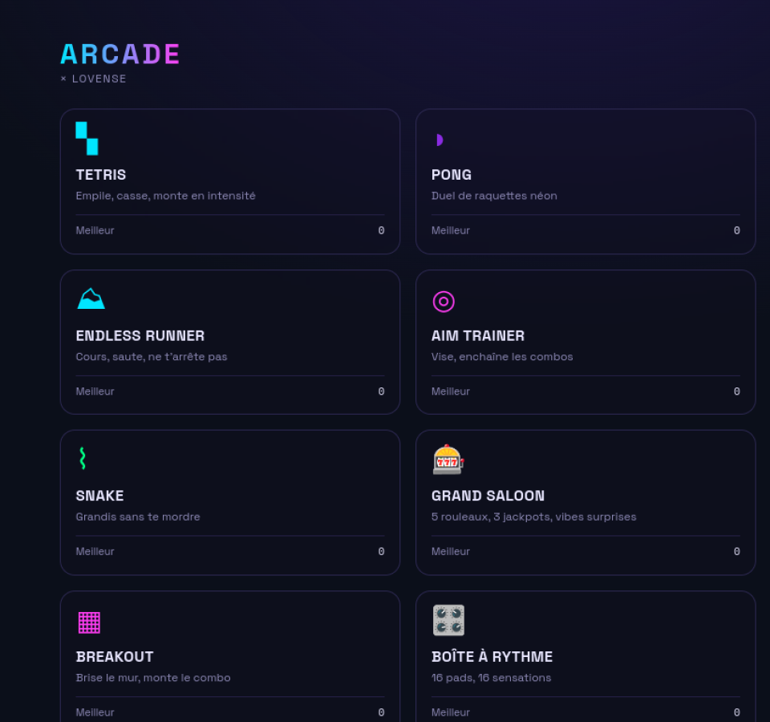

# Lovense Arcade

**Une référence open source pour concevoir des jeux navigateur à retour haptique sûr.**

🎮 **[Jouer à la démo en ligne](https://lovense-game.vercel.app)**



Lovense Arcade est une collection de mini-jeux néon construite avec Next.js et TypeScript. Les événements de jeu peuvent piloter un appareil compatible par l’API locale **Lovense Game Mode**. Tous les jeux restent jouables sans appareil ; le contrôleur partagé fournit une simulation et des journaux aux intégrations qui l’utilisent.

Le projet documente une approche réutilisable : moteurs de jeu séparés du rendu, événements sémantiques, effets haptiques bornés et arrêt explicite. Il ne revendique pas de validation sur matériel réel ; cette étape reste à effectuer par chaque utilisateur avec son propre appareil et son environnement réseau.

## Les 12 jeux disponibles

Le registre [`lib/games.ts`](lib/games.ts) déclare actuellement ces douze jeux comme prêts :

| Jeu | Principe |
| --- | --- |
| **Tetris** | Empiler, compléter des lignes et faire progresser l’intensité. |
| **Pong** | Duel de raquettes néon. |
| **Endless Runner** | Courir, sauter et éviter les obstacles. |
| **Aim Trainer** | Viser rapidement et enchaîner les combos. |
| **Snake** | Grandir sans percuter son propre corps. |
| **Grand Saloon** | Machine à sous à cinq rouleaux et trois jackpots. |
| **Breakout** | Briser le mur de briques et faire monter le combo. |
| **Boîte à Rythme** | Jouer avec 16 pads et leurs retours haptiques. |
| **Scanline** | Suivre une ligne de balayage et tenir le tempo. |
| **Neon Tiles** | Frapper les tuiles au bon moment. |
| **Descente** | Roguelike où l’exposition au risque pilote l’intensité. |
| **Number Bloom** | Tirer, fusionner des nombres et déclencher des chaînes. |

## Principes d’architecture

- **Next.js App Router**, **React**, **TypeScript** et **Tailwind CSS v4**.
- Export entièrement statique (`output: "export"`) : aucun backend applicatif n’est requis.
- HUB et routes dans `app/`, composants partagés dans `components/`.
- Registre des jeux dans `lib/games.ts` et moteurs de jeu dans `lib/`.
- État local, réglages et meilleurs scores conservés dans le navigateur.
- Intégration Lovense partagée dans `lib/lovense.ts`, avec adaptateurs spécialisés lorsque le jeu nécessite une orchestration plus fine.
- Moteurs et courbes haptiques testables indépendamment du rendu et du transport matériel.

## Sécurité haptique et mode démo

Le matériel n’est jamais nécessaire pour découvrir ou développer le projet : tous les jeux restent jouables sans connexion. En mode démo, le contrôleur partagé simule et journalise les effets pour les intégrations qui l’utilisent, sans envoyer de commande à un appareil.

Lorsqu’un appareil est utilisé :

- la connexion passe par Lovense Remote et son API locale Game Mode ;
- l’utilisateur choisit explicitement la connexion et l’appareil compatible ;
- les intensités sont bornées et les motifs ont une durée finie ;
- les effets sont déclenchés par des événements de jeu plutôt que par chaque image rendue ;
- les jeux concernés exposent un arrêt immédiat et coupent les effets lors des pauses, fins de partie ou démontages de page ;
- l’API locale ne doit jamais être publiée sur Internet ni exposée sur le réseau local par un relais non sécurisé.

Une fermeture brutale du navigateur ne garantit pas l’envoi d’une dernière requête réseau : les commandes finies limitent ce risque, mais ne remplacent pas la prudence de l’utilisateur. Aucune validation matérielle n’est revendiquée par le dépôt.

## Installation

### Prérequis

- Node.js récent ;
- npm ;
- Lovense Remote uniquement pour tester un appareil réel.

```bash
git clone git@github.com:m0nsieurdodo/lovenseGame.git
cd lovenseGame
npm ci
npm run dev
```

L’application est alors disponible sur <http://localhost:3000>.

### Vérifications

```bash
npm test
npm run build
```

La suite Vitest couvre notamment les moteurs purs, le scoring, les gestes, les courbes haptiques et des transports simulés.

## Trois implémentations de référence

### Scanline — rythme et horloge audio

Une ligne balaie verticalement l’écran au rythme d’une piste synthétisée. Le joueur frappe ou maintient les notes au passage de la ligne. Le timing repose sur `audioContext.currentTime`, avec quatre jugements : **PERFECT ±40 ms**, **GREAT ±80 ms**, **GOOD ±120 ms** et **MISS**.

- Baseline haptique pilotée par le combo, avec un palier tous les 25.
- Pulses événementiels associés aux jugements, additionnés puis bornés à 20.
- Beatmaps pilotées par les données : ajouter une piste ne demande pas de modifier le moteur. Le format est décrit dans [`lib/scanline/beatmaps/README.md`](lib/scanline/beatmaps/README.md).

### Descente — risque comme signal haptique

Ce roguelike top-down génère des étages de 5 à 8 salles et un boss. L’intensité suit l’exposition au risque, et non la récompense : le *heat meter* augmente dans une salle dangereuse, réagit aux combats, dégâts et pièges, puis décroît en zone sûre.

- `heatToIntensity(0–100) → 0–20`, avec courbes linéaire ou *ease-in*.
- Machine à états `idle / rising / spiking / decaying`, testée avec un temps injecté.
- Événements sémantiques (`combat_start`, `took_damage`, `room_cleared`, etc.) traduits uniquement par le `HapticDirector`.
- Reliques implémentées comme décorateurs du mapping haptique.
- **Espace** déclenche l’arrêt immédiat ; le réarmement est manuel. Le passage de l’onglet en arrière-plan met le jeu en pause et coupe la sortie.

### Number Bloom — commandes finies et consentement explicite

Ce shooter de fusion utilise cinq couloirs verticaux. Le bloc actif part du lanceur inférieur, rejoint sa pile et fusionne avec une valeur identique au point d’impact ; les réactions en chaîne remontent ensuite verticalement.

L’intégration Game Mode vérifie la capacité `Vibrate`, sérialise les motifs et utilise des durées finies. La valeur par défaut est plafonnée à **12/20** ; la dépasser demande une autorisation explicite. L’arrêt immédiat annule les effets en attente et bloque toute nouvelle commande jusqu’au réarmement.

Pour une connexion réelle :

1. activer **Discover → Game Mode → Enable LAN** dans Lovense Remote ;
2. conserver le navigateur et Lovense Remote sur le même réseau local ;
3. ouvrir les réglages de Number Bloom, activer volontairement la connexion et tester l’adresse locale ;
4. sélectionner uniquement un appareil annoncé compatible avec `Vibrate`.

En cas de blocage CORS, certificat ou politique réseau, ne contournez pas les protections. Le relais optionnel est réservé au navigateur du même ordinateur et écoute sur `127.0.0.1` :

```bash
LOVENSE_REMOTE_URL=https://192-168-1-20.lovense.club:30010 npm run lovense-relay
```

Il ne doit jamais être publié ni configuré pour écouter sur Internet ou sur le LAN. Sur mobile, utilisez le chemin HTTPS local pris en charge par Lovense Remote.

## Contribuer

Les corrections, nouveaux jeux et améliorations de sécurité sont les bienvenus. Consultez [`CONTRIBUTING.md`](CONTRIBUTING.md) avant d’ouvrir une pull request.

## Licence

Ce projet est distribué sous licence [MIT](LICENSE). Copyright © 2026 m0nsieurdodo.
